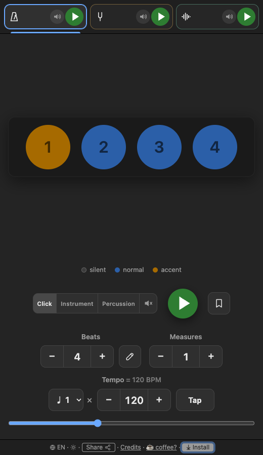
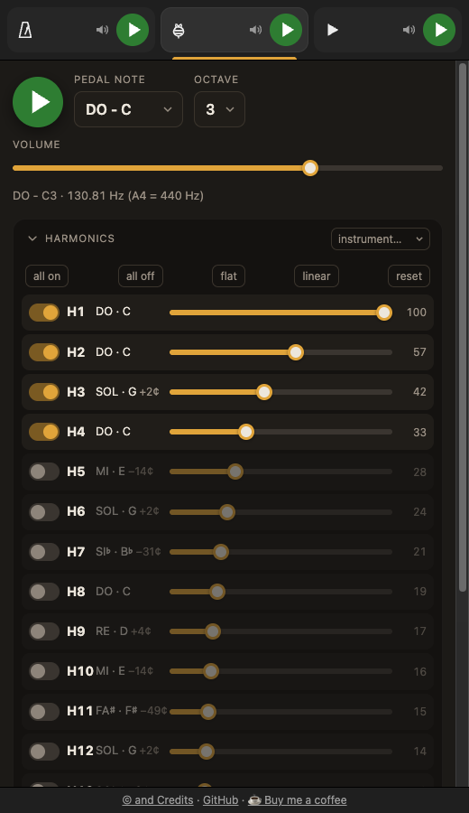
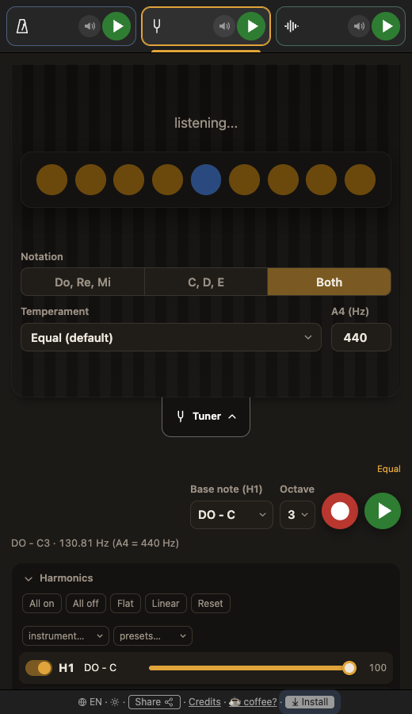

# Practice Room

A small, installable web app for music practice: a **metronome**, a **tuner**, a harmonic **drone** and an audio **player**, side by side. They can run at the same time, and the app works offline.

It is completely free and its source code is available (non-commercial license, see below): you can use it online or install it on your device. No ads, no tracking, no cookies. Settings are stored locally on your device.

Use it online or install: <https://mpascucci.github.io/practice-room/app>

  
  &nbsp;&nbsp;
  
  &nbsp;&nbsp;
  
  &nbsp;&nbsp;
  

## Features

- **Metronome**: an adjustable click with:
  - Tap tempo
  - Enter a custom beat sequence (e.g. `2 2 3`)
  - Click/Instrument/Percussion sounds
- **Drone**: a sustained pedal note with
  - Selectable note and octave
  - Instrument presets, and your own saved presets
  - Spectrometer to visualize the sound harmonics.
- **Tuner** (in the Drone tab)
  - Western temperaments (just, Pythagorean, meantone, Werckmeister, Kirnberger, Vallotti)
  - Ottoman (Holdrian 53-komma) and Arabic quarter-tone systems.
  - Reference note per temperament, or record it from a note you play
- **Player**: open or record an audio file.
  - Waveform you can zoom (pinch or mouse wheel)
  - Change speed without changing the pitch
  - Transpose up or down by up to an octave without changing the speed
  - A–B loop
  - Record a take with the microphone
  - Files stay on your device
- **Tabs with transport**: each app has its own play/stop button in the top bar, so you can start and stop either one without switching tabs.
- **Per-app volume**: a volume button on each tab sets the level of the metronome, drone and player independently.
- **Languages**: English, Italian, French, Spanish and German; follows the browser language, or pick one in the footer.
- **Responsive design**: works on phones, tablets and desktops.
- **Installable app**: Install and use offline on PC or mobile device.

## Install
1. Open the app: <https://mpascucci.github.io/practice-room/app>
2. Click the install button in the footer of the application, or add it to your home screen from the browser menu.

Once installed, Practice Room will work offline and you can use it without an internet connection.

## Credits

Some of the percussion sounds are taken from [Freesound](https://freesound.org/), and each has its own license; see [CREDITS.md](app/CREDITS.md).

## AI disclaimer

This project was built with the help of AI coding tools (Claude Code). The code has been tested by the author, but it comes with no warranty; see the license below.

## License

Copyright &copy; 2026 Marco Pascucci.

This software is licensed under the [PolyForm Noncommercial License 1.0.0](LICENSE): you are free to use, modify and share it for any non-commercial purpose. Commercial use requires a separate license from the author. The sound samples are under their own licenses; see [CREDITS.md](app/CREDITS.md).
