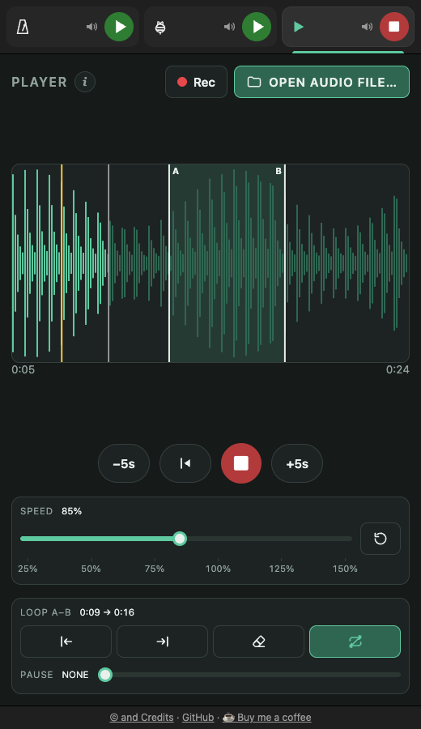

# Practice Room

A small, installable web app for music practice: a **metronome**, a harmonic **drone** and an audio **player**, side by side. They can run at the same time, and the app works offline.

It completely free and fully open sourc: you can use it online or install it on your device.

  
  &nbsp;&nbsp;
  
  &nbsp;&nbsp;
  

Use it online or install: <https://mpascucci.github.io/practice-room/app>

## Features

- **Metronome**: an adjustable click with:
  - Tap tempo
  - Enter a custom beat sequence (e.g. `2 2 3`).
  - Click/Instrument/Percussion sounds
- **Drone**: a sustained pedal note with
  - Selectable note and octave
  - Instrument presets.
- **Player**: open or record an audio file.
  - Waveform you can zoom (pinch or mouse wheel)
  - Change speed without changing the pitch
  - A–B loop
  - Record a take with the microphone
  - Files stay on your device.
- **Tabs with transport**: each app has its own play/stop button in the top bar, so you can start and stop either one without switching tabs.
- **Per-app volume**: a volume button on each tab sets the level of the metronome, drone and player independently.

- **Installable PWA**: add it to your home screen. A service worker caches everything for offline use.

- **Responsive design**: works on phones, tablets and desktops. The metronome, drone and player can be used together or separately.

## Credits

Some of the precussion sounds are taken from [Freesound](https://freesound.org/), and each has his own licence; see [CREDITS.md](app/CREDITS.md).

## AI disclaimer

This project was built with the help of AI coding tools (Claude Code). The code has been reviewed and tested by the author, but it comes with no warranty; see the license below.

## License

Copyright &copy; 2026 Marco Pascucci.

This software is licensed under the [PolyForm Noncommercial License 1.0.0](LICENSE): you are free to use, modify and share it for any non-commercial purpose. Commercial use requires a separate licence from the author. The Darabuka sounds are under their own non-commercial licence; see [CREDITS.md](app/CREDITS.md).
